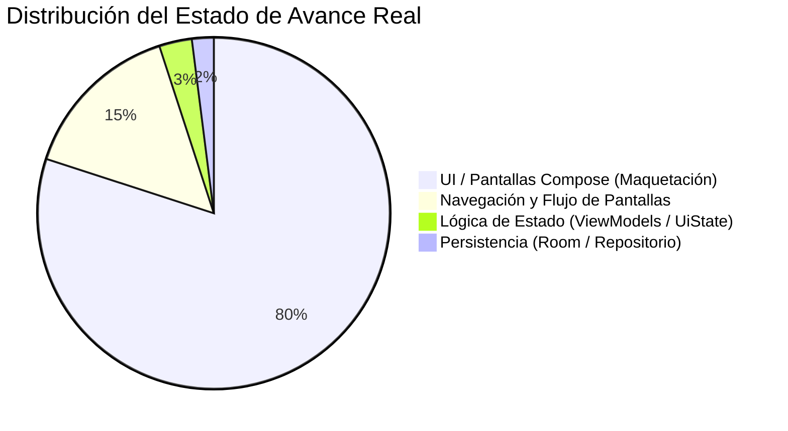
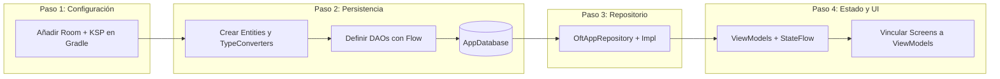

# Reporte de Estado y Arquitectura - OftAPP

**Fecha de emisión:** Octubre 2026  
**Proyecto:** OftAPP (Sistema Móvil de Consulta y Trazabilidad de Exámenes Oftalmológicos)  
**Plataforma objetivo:** Android (Jetpack Compose / Material Design 3)  
**Entorno de desarrollo:** Kotlin 2.2.10, Gradle 9.5.0, Android Gradle Plugin (AGP) 9.3.3, Target SDK 37  

---

## 1. Resumen General del Sistema

### 1.1. Estado de Compilación y Estabilidad General
El proyecto se encuentra en un estado **estable a nivel de compilación sintáctica y construcción Gradle**. La tarea de compilación en depuración se ejecuta de manera exitosa:

```bash
Calculating task graph as no cached configuration is available for tasks: compileDebugKotlin
> Task :app:compileDebugKotlin UP-TO-DATE
BUILD SUCCESSFUL in 3s
```

* **Estabilidad en tiempo de ejecución:** El árbol composable se renderiza sin errores fatales (*crashes*) al navegar entre las rutas básicas.
* **Integridad sintáctica:** No se detectan errores de enlace de tipos ni referencias no resueltas.
* **Observación crítica de estabilidad:** La aplicación es completamente volátil. Debido a que el estado vive únicamente en la memoria de las vistas (`remember { mutableStateOf(...) }`), no existe retención ante cambios de configuración profundos ni persistencia entre sesiones.

### 1.2. Fase de Desarrollo Detectada
El proyecto se ubica formalmente en la **Fase de Prototipado y Maquetación Avanzada de Interfaz de Usuario (UI / Wireframing Interactivo)** con una brecha sustancial hacia la lógica de negocio y la capa de datos.



* **Capa de Presentación (UI):** **80% - 85% completada.** Las siete pantallas contempladas en el flujo del MVP cuentan con una maquetación detallada, tipografía y paleta clínica definida, componentes Material Design 3 y elementos interactivos nativos (selectores de fecha y explorador de archivos SAF).
* **Capa de Lógica (ViewModels / Estado):** **5% completada.** Existe un único archivo ViewModel (`AppViewModel.kt`) sin implementación funcional. No hay estados unificados (`UiState`), ni reactividad con `StateFlow` o `SharedFlow`.
* **Capa de Persistencia (Base de Datos / Repositorios):** **0% en funcionamiento.** Existen clases de modelo de datos (`Consulta`, `Examen`, etc.), pero la base de datos Room, sus entidades, interfaces DAO y repositorios **no han sido implementados**.

---

## 2. Estructura de Paquetes y Arquitectura

### 2.1. Árbol de Directorios del Código Fuente
La estructura actual del módulo principal (`:app`) se organiza de la siguiente manera:

```text
D:\OftAPP\app\src\main\
├── AndroidManifest.xml
├── java\com\example\oftapp\
│   ├── MainActivity.kt
│   ├── model\
│   │   ├── Consulta.kt
│   │   ├── Documento.kt
│   │   ├── Examen.kt
│   │   ├── Paciente.kt
│   │   └── Usuario.kt
│   ├── navigation\
│   │   └── OftAppNavigation.kt
│   ├── ui\
│   │   ├── screens\
│   │   │   ├── CargaDocumentosScreen.kt
│   │   │   ├── DashboarScreen.kt       <-- (Typo en nombre: falta la 'd')
│   │   │   ├── DetalleExamenScreen.kt
│   │   │   ├── HistorialClinicoScreen.kt
│   │   │   ├── ListadoBusquedaScreen.kt
│   │   │   ├── LoginScreen.kt
│   │   │   └── RegsitroAtencionScreen.kt <-- (Typo en nombre: 'si' por 'is')
│   │   └── theme\
│   │       ├── Color.kt
│   │       ├── Theme.kt
│   │       └── Type.kt
│   └── viewmodel\
│       └── AppViewModel.kt
└── res\
    ├── values\
    │   ├── colors.xml
    │   ├── strings.xml
    │   └── themes.xml
    └── ... (iconos mipmap y xml de respaldo)
```

### 2.2. Patrón de Arquitectura: Estado Teórico vs. Estado Real

* **Patrón Declarado (según documentación y especificaciones):**  
  **MVVM (Model - ViewModel - View) + Repository Pattern**, con separación en capas: Presentación (`ui`), Dominio/Lógica (`viewmodel`), y Datos (`data` con Room).
* **Patrón Realmente Aplicado:**  
  **Monolito de Vistas Autónomas ("Smart Composables")**. Cada pantalla asume simultáneamente responsabilidades de presentación, almacenamiento de estado local y generación de datos simulados (*mock data*). No se observa la separación de responsabilidades requerida por los lineamientos de arquitectura moderna de Android (*Modern Android Architecture - MAD*).

```mermaid
graph TD
    subgraph Arquitectura Actual (En Código)
        UI[Pantallas Compose con Mock Data] --> Nav[OftAppNavigation]
        UI -.-> VM_Vacio[AppViewModel Desconectado]
    end

    subgraph Arquitectura Objetivo (MVVM + Repository)
        V[Jetpack Compose UI] -->|Eventos| VM[ViewModels con StateFlow]
        VM -->|UiState reactivo| V
        VM --> Repo[OftAppRepository]
        Repo --> DAO[Room DAOs]
        DAO --> DB[(Room Database SQLite)]
    end
```

---

## 3. Capa de Presentación (UI & Navegación)

### 3.1. Detalle de Pantallas Implementadas (`*Screen.kt`)

| Archivo | Función Composable Principal | Descripción y Componentes Clave | Estado y Dependencias |
| :--- | :--- | :--- | :--- |
| `LoginScreen.kt` | `LoginScreen(onLoginSuccess)` | Pantalla de bienvenida y autenticación. Contiene ícono institucional (`Icons.Default.Visibility`), dos campos de texto (`OutlinedTextField`) para usuario/correo y contraseña, y botón de acción principal. | Simulación directa. Define `selectedRole = "Tecnólogo Médico"`. No expone selector visual de roles; al pulsar "Iniciar Sesión" navega sin validar credenciales. |
| `DashboarScreen.kt` | `DashboardScreen(...)` | Centro de operaciones. Consta de `TopAppBar` con badge de notificación, `FloatingActionButton` (+), `NavigationBar` inferior de 4 destinos, banner con saludo personalizado, 4 botones rápidos (`QuickActionButton`), 3 métricas sumarias (`SummaryTile`) y tarjeta de examen reciente (`RecentExamCard`). | Datos 100% estáticos ("Dra. Carla Ruiz", Sede Norte, contadores 1, 2, 1). Redefine su propia paleta de colores (`OftPrimary`, etc.) de forma local. |
| `RegsitroAtencionScreen.kt` | `RegistroAtencionScreen(...)` | Formulario de admisión médica. Incluye campo ID paciente (`PAC-XXXXX`), selector de fecha con diálogo nativo `DatePickerDialog`, menú desplegable `ExposedDropdownMenuBox` para sedes, botones conmutables para examen (Campimetría, Topografía) y ojo (OD, OI). | Estado local mediante `remember`. Al presionar "Siguiente: Cargar Documentos", **no persiste la información**: navega sin guardar. |
| `CargaDocumentosScreen.kt` | `CargaDocumentosScreen(...)` | Gestor de anexos médicos. Integra el contrato `ActivityResultContracts.GetContent()` para abrir el explorador del sistema (`*/*`), consulta el `ContentResolver` para extraer nombre y tamaño real del archivo, y muestra una tarjeta con indicador de progreso. | Captura la URI en memoria local. El botón "Terminar" solo retorna al Dashboard sin asociar el anexo a un examen o paciente. |
| `ListadoBusquedaScreen.kt` | `ListadoBusquedaScreen(...)` | Explorador y buscador de fichas médicas. Dispone de un `OutlinedTextField` de búsqueda con botón de limpieza, y una `LazyColumn` que filtra en tiempo real por nombre, tipo de examen o código ID. | Define su propio modelo interno `data class ExamenItem` y una lista fija de 4 pacientes/exámenes ficticios en memoria. |
| `DetalleExamenScreen.kt` | `DetalleExamenScreen(examId, ...)` | Ficha integral del examen. Estructurada mediante scroll vertical con tres tarjetas: información clínica general (`InfoExamenCard`), descarga de documento anexo (`ArchivoAdjuntoCard`) y caja de observaciones diagnósticas (`ObservacionesCard`). | Recibe `examId` pero el resto del contenido es estático (María González, Campimetría OD, PDF adjunto de 2.4 MB). Botones de validar y descargar sin lógica asociada. |
| `HistorialClinicoScreen.kt` | `HistorialClinicoScreen(...)` | Línea de tiempo cronológica del paciente. Posee selector de paciente (`ExposedDropdownMenuBox`), tarjeta resumen con diagnóstico oftalmológico base y una lista cronológica (`TimelineExamCard`) con nodos visuales (verde para validado, rojo para pendiente). | Define localmente `PatientMock` y `ExamMock` con 2 pacientes y 2 exámenes de prueba. Redefine constantes de color locales. |

### 3.2. Sistema de Navegación (`NavHost`)
La navegación está centralizada en `com/example/oftapp/navigation/OftAppNavigation.kt`:

* **Controlador:** Gestionado con `rememberNavController()`.
* **Destino Inicial:** `"login"`.
* **Estado Global Compartido:** Variable en memoria `var currentRole by remember { mutableStateOf("") }` que almacena el rol capturado en el inicio de sesión.

```mermaid
flowchart TD
    Login["login (LoginScreen)"] -->|onLoginSuccess(role)| Dashboard["dashboard (DashboardScreen)"]
    
    Dashboard -->|onNavigateToRegister| Registro["registro (RegistroAtencionScreen)"]
    Dashboard -->|onNavigateToUpload| Carga["carga_documentos (CargaDocumentosScreen)"]
    Dashboard -->|onNavigateToSearch| Listado["listado (ListadoBusquedaScreen)"]
    Dashboard -->|onNavigateToHistory| Historial["historial (HistorialClinicoScreen)"]

    Registro -->|onNextToDocumentUpload| Carga
    Carga -->|onFinishUpload: popBackStack| Dashboard

    Listado -->|onExamSelected(id)| Detalle["detalle/{examId} (DetalleExamenScreen)"]
    Historial -->|onSelectExam(id)| Detalle
    Historial -->|onNavigateToHome: popUpTo| Dashboard
    Historial -->|onNavigateToSearch| Listado
    Detalle -->|onBack: popBackStack| DetalleBack[Retorno a vista previa]
```

* **Evaluación del paso de argumentos:**  
  La ruta `"detalle/{examId}"` extrae el parámetro mediante:
  ```kotlin
  val examId = backStackEntry.arguments?.getString("examId") ?: ""
  ```
  Sin embargo, este valor solo se utiliza como etiqueta de texto en pantalla; no dispara ninguna consulta hacia una capa de datos.

### 3.3. Tema Clínico y Sistema de Diseño Visual
* **Tokens de Color Centrales (`ui/theme/Color.kt`):**
  * `AzulClinico = Color(0xFF006689)`: Color primario (TopAppBar, botones principales, acentos).
  * `GrisAzulado = Color(0xFF4F616E)`: Color secundario (bordes, textos atenuados).
  * `BlancoClinico = Color(0xFFF8FDFF)`: Fondo general y superficies limpias.
  * `TextoOscuro = Color(0xFF191C1E)`: Textos principales de alto contraste.
  * `VerdeSalud = Color(0xFF006E36)`: Estados clínicos favorables ("Validado").
  * `RojoAlerta = Color(0xFFB02F00)`: Alertas, PDFs y estados clínicos pendientes.
* **Configuración del Esquema (`ui/theme/Theme.kt`):**
  * Define `LightColorScheme` y `DarkColorScheme`.
  * `dynamicColor` se encuentra desactivado explícitamente (`dynamicColor: Boolean = false`) para garantizar consistencia visual con la identidad médica institucional en Android 12+.
* **Inconsistencias Detectadas:**
  * En `DashboarScreen.kt` se omitieron los tokens globales y se definieron valores hex privados (`OftPrimary = Color(0xFF00647C)`, `OftBorder`, etc.).
  * En `HistorialClinicoScreen.kt` se reescribieron 9 definiciones de color en el encabezado del archivo.

---

## 4. Capa de Datos (Room Database & Repositorio)

### 4.1. Modelos Existentes (`com.example.oftapp.model`)
Actualmente residen cinco clases de datos simples de Kotlin sin anotaciones de persistencia:

```kotlin
// Consulta.kt
data class Consulta(
    val id: String,
    val pacienteId: String,
    val fecha: Date,
    val sucursal: String,
    val profesionalACargo: String
)

// Documento.kt
data class Documento(
    val id: String,
    val examenId: String,
    val nombreArchivo: String
)

// Examen.kt
data class Examen(
    val id: String,
    val atencionId: String,
    val tipoExamen: String,
    val estado: String,
    val observaciones: String
)

// Paciente.kt
data class Paciente(
    val id: String,
    val email: String,
    val nombreCompleto: String
)

// Usuario.kt
data class Usuario(
    val id: String,
    val email: String,
    val rol: String
)
```

### 4.2. Brecha Estructural en la Capa de Persistencia
A continuación se contrasta la especificación esperada frente a la realidad del código fuente:

| Componente Room | Estado Actual | Detalle del Diagnóstico |
| :--- | :--- | :--- |
| **Entidades (`*Entity`)** | **Inexistentes** | Ningún modelo contiene `@Entity`, `@PrimaryKey`, `@ColumnInfo` ni `@ForeignKey`. En su lugar coexisten modelos duplicados como `ExamenItem` (en `ListadoBusquedaScreen`) o `PatientMock` / `ExamMock` (en `HistorialClinicoScreen`). |
| **Interfaces DAO (`*Dao`)** | **Inexistentes** | No existe `ExamDao`, `PacienteDao` ni `UsuarioDao`. No hay consultas implementadas (`@Query`, `@Insert`, `@Update`, `@Delete`). |
| **Conversores (`TypeConverter`)**| **Inexistentes** | La entidad `Consulta` utiliza `java.util.Date`, el cual no es primitivo en SQLite y requiere un `@TypeConverter` (Long <-> Date). Tampoco existen conversores para URIs ni Enums. |
| **Base de Datos (`AppDatabase`)** | **Inexistente** | No existe ninguna clase que herede de `RoomDatabase`. |
| **Patrón Repositorio** | **Inexistente** | No existe la interfaz `OftAppRepository` ni su implementación de acceso a datos locales. |

---

## 5. Capa de Estado y Lógica (ViewModels)

### 5.1. Situación Actual de los ViewModels
El paquete `com.example.oftapp.viewmodel` contiene únicamente:

```kotlin
package com.example.oftapp.viewmodel

import androidx.lifecycle.ViewModel

class AppViewModel: ViewModel() {

}
```

* **Estado de `AppViewModel`:** Clase vacía sin atributos, sin métodos, sin inyección de dependencias y sin corrutinas.
* **ViewModels de Pantalla Faltantes:** No existen `LoginViewModel`, `DashboardViewModel`, `RegistroAtencionViewModel`, `ListadoBusquedaViewModel`, `DetalleExamenViewModel` ni `HistorialClinicoViewModel`.
* **Modelado de Estados (`UiState`):** No se han declarado clases de datos ni interfaces selladas para representar estados de carga (`Loading`), éxito con datos (`Success`) o error (`Error`).

### 5.2. Vinculación Real UI <-> ViewModel
* **Grado de Vinculación:** **0%**.
* Ninguna de las funciones `@Composable` del proyecto recibe un ViewModel por parámetro o mediante el asistente `viewModel()`.
* **Riesgo:** Si el usuario rota el dispositivo, minimiza la aplicación o el sistema libera memoria, todos los datos ingresados en el formulario de registro y la selección de archivos se destruyen de inmediato.

---

## 6. Dependencias y Configuración del Proyecto

### 6.1. Análisis de `build.gradle.kts` y `libs.versions.toml`

#### Catálogo de Versiones (`gradle/libs.versions.toml`)
* `agp = "9.3.3"`
* `kotlin = "2.2.10"`
* `composeBom = "2026.02.01"`
* `coreKtx = "1.19.1"`
* `lifecycleRuntimeKtx = "2.11.0"`
* `activityCompose = "1.13.0"`
* `junit = "4.13.2"`, `junitVersion = "1.3.0"`, `espressoCore = "3.7.0"`

#### Dependencias Activas en `app/build.gradle.kts`
```kotlin
dependencies {
    implementation(platform(libs.androidx.compose.bom))
    implementation(libs.androidx.activity.compose)
    implementation(libs.androidx.compose.material3)
    implementation(libs.androidx.compose.ui)
    implementation(libs.androidx.compose.ui.graphics)
    implementation(libs.androidx.compose.ui.tooling.preview)
    implementation(libs.androidx.core.ktx)
    implementation(libs.androidx.lifecycle.runtime.ktx)
    implementation("androidx.navigation:navigation-compose:2.10.1")
    implementation("androidx.lifecycle:lifecycle-viewmodel-compose:2.11.0")
    implementation("androidx.compose.material:material-icons-extended")
    testImplementation(libs.junit)
    androidTestImplementation(platform(libs.androidx.compose.bom))
    androidTestImplementation(libs.androidx.compose.ui.test.junit4)
    androidTestImplementation(libs.androidx.espresso.core)
    androidTestImplementation(libs.androidx.junit)
    debugImplementation(libs.androidx.compose.ui.test.manifest)
    debugImplementation(libs.androidx.compose.ui.tooling)
}
```

* **Dependencias Ausentes Críticas:**
  1. **Room:** No están declaradas `androidx.room:room-runtime` ni `androidx.room:room-ktx`.
  2. **Procesador de Anotaciones (KSP):** No está aplicado el plugin `com.google.devtools.ksp` indispensable para generar el código de Room bajo Kotlin 2.x.
  3. **Inyección de Dependencias:** No se dispone de Hilt (`com.google.dagger.hilt.android`) ni Koin.

### 6.2. Permisos y Manifiesto (`AndroidManifest.xml`)
El archivo de manifiesto cuenta con la siguiente configuración:

```xml
<?xml version="1.0" encoding="utf-8"?>
<manifest xmlns:android="http://schemas.android.com/apk/res/android"
    xmlns:tools="http://schemas.android.com/tools">

    <application
        android:allowBackup="true"
        android:dataExtractionRules="@xml/data_extraction_rules"
        android:fullBackupContent="@xml/backup_rules"
        android:icon="@mipmap/ic_launcher"
        android:label="@string/app_name"
        android:roundIcon="@mipmap/ic_launcher_round"
        android:supportsRtl="true"
        android:theme="@style/Theme.OftAPP">
        <activity
            android:name=".MainActivity"
            android:exported="true"
            android:label="@string/app_name"
            android:theme="@style/Theme.OftAPP"
            android:windowSoftInputMode="adjustResize">
            <intent-filter>
                <action android:name="android.intent.action.MAIN" />
                <category android:name="android.intent.category.LAUNCHER" />
            </intent-filter>
        </activity>
    </application>
</manifest>
```

* **Evaluación de Permisos:** No hay declaraciones `<uses-permission>`.
  * La aplicación utiliza el contrato SAF (`GetContent`), por lo cual no requiere obligatoriamente permisos de almacenamiento en versiones modernas para lectura puntual en el launcher.
  * Sin embargo, para persistir el acceso a los archivos seleccionados tras reiniciar la aplicación, se requiere invocar `contentResolver.takePersistableUriPermission`.
  * Si a futuro se requiere sincronización remota o consulta a APIs externas, deberá agregarse `android.permission.INTERNET`.

---

## 7. Diagnóstico de Componentes Faltantes y Brechas

### 7.1. Matriz de Brechas y Datos Hardcodeados

| Pantalla / Módulo | Elementos Hardcodeados Detectados | Impacto Técnico / Funcional |
| :--- | :--- | :--- |
| `LoginScreen` | Rol `"Tecnólogo Médico"`. No existe validación de credenciales contra base de datos. | Cualquier combinación de usuario/clave permite el ingreso; no es posible alternar entre médico, tecnólogo o paciente desde la interfaz. |
| `DashboardScreen` | Nombre del médico ("Dra. Carla Ruiz"), contadores (1, 2, 1), tarjeta reciente fija. | La pantalla no refleja la realidad operativa ni reacciona a nuevos exámenes registrados. |
| `RegistroAtencionScreen` | Sedes y tipos de exámenes fijos; los valores ingresados se pierden al pulsar "Siguiente". | No se crea la entidad en la base de datos ni se genera un identificador relacional para el paso siguiente. |
| `CargaDocumentosScreen` | La URI del archivo queda retenida en el estado local del Composable. | No se almacena la referencia en la base de datos ni se copia el archivo al almacenamiento interno privado de la aplicación. |
| `ListadoBusquedaScreen` | Lista en memoria de 4 exámenes con modelo desacoplado (`ExamenItem`). | Los nuevos registros no aparecen en la búsqueda; no hay paginación ni consulta SQL reactiva. |
| `DetalleExamenScreen` | Paciente, fecha, sede, archivo `campimetria_OD.pdf` y observaciones fijas. | El parámetro `examId` de la URL se visualiza como texto pero no recupera la ficha correspondiente. |
| `HistorialClinicoScreen` | Modelos `PatientMock` y `ExamMock` con dos pacientes fijos. | No es posible examinar el historial clínico de pacientes registrados dinámicamente. |

### 7.2. Tareas Críticas Pendientes de Implementación



1. **Configuración de Dependencias:**
   * Incorporar el plugin `com.google.devtools.ksp` compatible con Kotlin 2.2.10.
   * Añadir las dependencias de Room (`androidx.room:room-runtime` y `androidx.room:room-ktx`) en `libs.versions.toml` y `app/build.gradle.kts`.
2. **Definición de Entidades Room:**
   * Transformar las clases del paquete `model` en entidades con `@Entity(tableName = "...")`, `@PrimaryKey(autoGenerate = ...)` y claves foráneas `@ForeignKey` para mantener integridad referencial entre `Paciente`, `Consulta`, `Examen` y `Documento`.
3. **Conversores de Tipos (`TypeConverters`):**
   * Crear la clase `Converters` para transformar tipos complejos:
     * `Date` <-> `Long` (milisegundos Unix)
     * `Uri` <-> `String`
4. **Implementación de DAOs:**
   * Construir interfaces DAO que expongan operaciones reactivas mediante Kotlin `Flow`:
     * `ExamenDao`: `@Query("SELECT * FROM examenes") fun getAll(): Flow<List<ExamenEntity>>`
     * Inserciones con `@Insert(onConflict = OnConflictStrategy.REPLACE)`.
5. **Capa de Repositorio:**
   * Diseñar la interfaz `OftAppRepository` y su clase concreta `OftAppRepositoryImpl` como única fuente de la verdad (*Single Source of Truth*).
6. **Desarrollo de ViewModels y Estados (`UiState`):**
   * Reemplazar el `AppViewModel` vacío por ViewModels especializados por flujo o pantalla (ej. `DashboardViewModel`, `RegistroExamenViewModel`).
   * Exponer estados inmutables `StateFlow<UiState>` y consumir en la UI mediante `collectAsStateWithLifecycle()`.
7. **Correcciones Técnicas Menores:**
   * Corregir el nombre de los archivos `DashboarScreen.kt` (a `DashboardScreen.kt`) y `RegsitroAtencionScreen.kt` (a `RegistroAtencionScreen.kt`).
   * Unificar el uso de tokens de color, eliminando las variables duplicadas en `DashboarScreen.kt` e `HistorialClinicoScreen.kt`.

---
*Reporte generado minuciosamente a partir del análisis estático y dinámico del repositorio fuente.*
