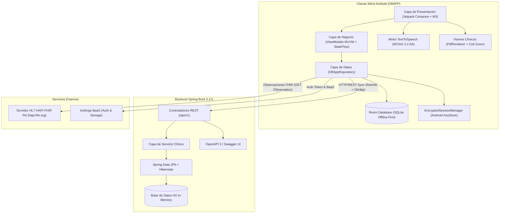

# OftAPP — Sistema Clínico Oftalmológico Especializado

[](https://developer.android.com/)
[](https://kotlinlang.org/)
[](https://developer.android.com/jetpack/compose)
[](https://spring.io/projects/spring-boot)
[](https://hl7.org/fhir/)
[](https://www.w3.org/WAI/standards-guidelines/wcag/)

**OftAPP** es una plataforma móvil y backend clínico de alta especialización oftalmológica diseñada para la trazabilidad integral de exámenes visuales, gestión de consultas médicas, interoperabilidad hospitalaria y asistencia accesible. Ofrece una arquitectura **Offline-First**, visores clínicos integrados sin dependencia de visores de terceros, síntesis de voz para diagnósticos y un estricto control de acceso basado en roles (RBAC).

---

## 📑 Tabla de Contenidos

1. [Capacidades Clave del Sistema](#-capacidades-clave-del-sistema)
2. [Arquitectura del Sistema](#-arquitectura-del-sistema)
3. [Requisitos Previos y Entorno](#-requisitos-previos-y-entorno)
4. [Instrucciones de Despliegue y Ejecución](#-instrucciones-de-despliegue-y-ejecución)
   - [1. Backend Spring Boot REST API](#1-backend-spring-boot-rest-api)
   - [2. Aplicación Móvil Android](#2-aplicación-móvil-android)
5. [Matriz de Roles y Credenciales de Prueba](#-matriz-de-roles-y-credenciales-de-prueba)
6. [Visores Clínicos Integrados](#-visores-clínicos-integrados)
7. [Seguridad y Protección de Datos](#-seguridad-y-protección-de-datos)
8. [Accesibilidad Universal WCAG 2.2 AA](#-accesibilidad-universal-wcag-22-aa)
9. [Configuración de Build Release y Ofuscación R8](#-configuración-de-build-release-y-ofuscación-r8)

---

## 👁️ Capacidades Clave del Sistema

* **Trazabilidad de Exámenes Clínicos:** Registro de procedimientos estándar: Campimetría, Tonometría, OCT Retinal y Fundoscopía, con diferenciación estricta de ojo evaluado (`OD`, `OI`, `Bifocal`).
* **Operación Offline-First con Sincronización Automática:** Almacenamiento local reactivo en **Room (SQLite)**. Detección de conectividad en tiempo real mediante `NetworkConnectivityObserver` y sincronización por lotes (`POST /api/v1/sync`) hacia el backend central cuando se restablece la conexión.
* **Interoperabilidad Hospitalaria HL7 HAPI FHIR R4:** Consulta y normalización en vivo de observaciones clínicas estandarizadas desde el servidor público `https://hapi.fhir.org/baseR4`.
* **Autenticación Híbrida y Sesión Criptográfica:** Integración con **Insforge BaaS SDK** respaldada por `EncryptedSharedPreferences` sobre **Android KeyStore** (AES-256-GCM / MasterKey).
* **Visores Clínicos Integrados (In-App):**
  * *PDF Nativo:* Renderizado vectorial directo mediante `android.graphics.pdf.PdfRenderer` con paginación táctil y exportación a la carpeta de descargas.
  * *Imágenes Médicas:* Visualización de retinografías y topografías con multitouch (zoom continuo 1x a 5x, paneo y controles de accesibilidad).
* **Accesibilidad Extrema WCAG 2.2 AA:** Paleta de alto contraste ($\ge 7:1$), factor de escalado de fuentes dinámico (1.0x, 1.2x, 1.4x), síntesis de voz con `TextToSpeech` en español y áreas táctiles garantizadas ($\ge 48\text{ dp}$).

---

## 🏛️ Arquitectura del Sistema

El ecosistema de OftAPP sigue una arquitectura moderna, limpia y desacoplada estructurada en capas:



---

## 📦 Requisitos Previos y Entorno

* **Java Development Kit (JDK):** Versión 17 o 21 (LTS).
* **Android Studio:** Ladybug (2024.2.1) o superior.
* **Android SDK:**
  * `compileSdk`: 35 / 37
  * `minSdk`: 24 (Android 7.0 Nougat o superior)
  * `targetSdk`: 35 / 37
* **Build Tools & Gradle:** Gradle 8.x / 9.x con Kotlin Compose Compiler Plugin.
* **Apache Maven:** 3.9+ (o utilizar el wrapper `mvnw` incluido en `backend/`).

---

## 🚀 Instrucciones de Despliegue y Ejecución

### 1. Backend Spring Boot REST API

El backend clínico provee endpoints REST, base de datos H2 con precarga de datos (DataSeeder) y documentación Swagger interactiva.

1. Abre una terminal y sitúate en la carpeta `backend/`:
   ```bash
   cd backend
   ```

2. Ejecuta el servidor mediante Maven Wrapper:
   * **En Windows (PowerShell / CMD):**
     ```powershell
     .\mvnw.cmd spring-boot:run
     ```
   * **En Linux / macOS:**
     ```bash
     chmod +x mvnw
     ./mvnw spring-boot:run
     ```

3. Verifica la disponibilidad de los servicios en tu navegador:
   * **Documentación Interactiva Swagger UI:** [http://localhost:8080/swagger-ui/index.html](http://localhost:8080/swagger-ui/index.html)
   * **Especificación OpenAPI 3 (JSON):** [http://localhost:8080/v3/api-docs](http://localhost:8080/v3/api-docs)
   * **Consola de Base de Datos H2:** [http://localhost:8080/h2-console](http://localhost:8080/h2-console)
     * *JDBC URL:* `jdbc:h2:mem:oftappdb`
     * *Usuario:* `sa`
     * *Contraseña:* *(dejar en blanco)*

---

### 2. Aplicación Móvil Android

1. **Configuración de Variables Locales (`local.properties`):**
   Copia la plantilla `local.properties.example` hacia `local.properties` en la raíz del repositorio y define las credenciales de tu entorno:
   ```properties
   ## Ubicación del Android SDK (configurado por Android Studio)
   sdk.dir=C\:\\Users\\<tu-usuario>\\AppData\\Local\\Android\\Sdk

   ## Credenciales de Insforge BaaS
   INSFORGE_BASE_URL=https://3cz6k2zd.us-east.insforge.app
   INSFORGE_ANON_KEY=ik_a90d867e90779254a1989da7ddd30181

   ## Configuración opcional de Firma Digital Release (keystore)
   RELEASE_STORE_FILE=release-keystore.jks
   RELEASE_STORE_PASSWORD=tu_password_segura
   RELEASE_KEY_ALIAS=oftapp_release
   RELEASE_KEY_PASSWORD=tu_password_alias
   ```

2. **Compilación e Instalación en Modo Debug:**
   Para compilar e instalar en un emulador o dispositivo físico conectado por depuración USB:
   ```powershell
   ./gradlew installDebug
   ```
   O ejecutar el inicio de la actividad principal con ADB:
   ```powershell
   adb shell am start -n com.example.oftapp/.MainActivity
   ```

3. **Compilación de Producción (Release APK optimizado y ofuscado con R8):**
   ```powershell
   ./gradlew assembleRelease
   ```
   El binario optimizado se generará en:
   `app/build/outputs/apk/release/`

---

## 👥 Matriz de Roles y Credenciales de Prueba

El sistema implementa **Control de Acceso Basado en Roles (RBAC)** validado criptográficamente en el dispositivo y forzado mediante headers (`X-User-Role`) en el backend REST:

| Rol Clínico | Correo de Prueba | Contraseña | Nombre y RUT | Permisos y Alcance en OftAPP |
|---|---|---|---|---|
| **`MEDICO`** | `medico@oftapp.cl` | `OftApp2026!` | Dra. Carla Ruiz<br>`11.111.111-1` | Acceso global a pacientes, revisión diagnóstica, historial cronológico y **validación clínica definitiva** de exámenes. |
| **`TECNOLOGO`** | `tecnologo@oftapp.cl` | `OftApp2026!` | Lic. Andrés Gómez<br>`22.222.222-2` | Registro de atenciones médicas (`OD`/`OI`/`Bifocal`), captura de notas clínicas y **carga de documentos adjuntos** (PDF/imágenes). |
| **`ADMIN`** | `admin@oftapp.cl` | `OftApp2026!` | Carlos Vega<br>`33.333.333-3` | Gestión institucional global, supervisión de sincronización offline, auditoría y consulta integral. |
| **`PACIENTE`** | `paciente@oftapp.cl` | `OftApp2026!` | Juan Pérez<br>`12.345.678-9` | **Portal del Paciente:** Consulta restringida exclusivamente a sus propias atenciones e informes. Bloqueo estricto contra registro o modificación (403 Forbidden). |

---

## 🔬 Visores Clínicos Integrados

OftAPP elimina la necesidad de instalar o conmutar hacia visores de terceros en Android, manteniendo al especialista en un flujo clínico seguro y contenido:

* **Visor PDF Nativo (`PdfRendererView`):**
  * Utiliza `android.graphics.pdf.PdfRenderer` y `ParcelFileDescriptor` para renderizado en hilo de fondo (`Dispatchers.IO`) con escalado nítido (2x) sobre lienzo blanco.
  * Paginación interactiva con botones accesibles (`Anterior` / `Siguiente`) e indicador visual y semántico `"Página X de Y"`.
  * Ciclo de vida protegido mediante `DisposableEffect` que garantiza el cierre de descriptores de archivo y reciclaje inmediato de memoria en `onDispose`.
  * Botón para exportar el documento PDF a la carpeta pública del dispositivo (`Descargas/OftAPP/`).

* **Visor de Imágenes Médicas (`ZoomableImageViewer`):**
  * Desarrollado para retinografías, topografías corneales y capturas de fondo de ojo con `SubcomposeAsyncImage` (Coil).
  * Soporte multitouch reactivo (`Modifier.pointerInput` + `detectTransformGestures`) para zoom continuo entre **1x y 5x** y desplazamiento bidimensional (paneo con límites de contención).
  * Botones flotantes accesibles en pantalla para usuarios que no utilicen gestos de pellizco (Zoom In, Zoom Out y Restablecer Vista).

---

## 🔒 Seguridad y Protección de Datos

1. **Almacenamiento Criptográfico Seguro:**
   * Las credenciales de sesión, tokens de autenticación y roles de usuario se resguardan en `EncryptedSharedPreferences` mediante la librería `androidx.security:security-crypto`, con claves simétricas maestras gestionadas por el **Android KeyStore del sistema** (`MasterKey.DEFAULT_MASTER_KEY_ALIAS`).
2. **Control de Acceso en Backend y Frontend (RBAC):**
   * Validación cruzada: la interfaz oculta acciones restringidas según el rol y el backend Spring Boot valida cada petición denegando registros a usuarios con rol `PACIENTE`.
3. **Privacidad de Secretos de Construcción:**
   * El archivo `.gitignore` excluye permanentemente `local.properties`, certificados `*.jks`, `*.keystore`, `*.key` y `*.pem`, garantizando que ninguna llave criptográfica sea expuesta en el control de versiones.

---

## ♿ Accesibilidad Universal WCAG 2.2 AA

OftAPP cumple rigurosamente con las directrices de accesibilidad digital para profesionales y pacientes con baja visión o dificultades motrices:

* **Paleta de Alto Contraste ($\ge 7:1$ - WCAG AAA/AA):**
  * Esquema de colores especialmente formulado con fondos puros (`#000000` / `#FFFFFF`), textos de alto contraste y acentos accesibles (`#80D8FF` y `#FFD600`).
* **Escalado Tipográfico Dinámico:**
  * Preferencias persistidas mediante **DataStore Preferences** con factores de multiplicación tipográfica: **100% (Normal)**, **120% (Medio)** y **140% (Grande)**.
  * Inyección a nivel raíz de Compose mediante `CompositionLocalProvider(LocalDensity provides customDensity)`, garantizando escalado proporcional sin truncamiento de interfaces.
* **Motor TextToSpeech Integrado:**
  * Módulo `TextToSpeechHelper` inicializado con prioridad en español (`es-CL` con fallback automático a `es-ES` y `es`).
  * Botón accesible **"Escuchar diagnóstico"** en el detalle del examen clínico para lectura en voz alta de paciente, tipo de examen, ojo evaluado, estado y notas clínicas.
  * Resumen general audible en el panel principal (`DashboardScreen`).
* **Áreas Táctiles y Semántica TalkBack:**
  * Todas las superficies interactivas (botones, chips de filtro, tarjetas clicables e íconos) poseen un tamaño mínimo garantizado de **$\ge 48\times 48\text{ dp}$** (`Modifier.defaultMinSize(minWidth = 48.dp, minHeight = 48.dp)`).
  * Etiquetas descriptivas en TalkBack (`role = Role.Button`, `role = Role.RadioButton`, `role = Role.Switch`, `contentDescription` contextuales y `mergeDescendants = true`).

---

## 🛠️ Configuración de Build Release y Ofuscación R8

El módulo de aplicación (`app/build.gradle.kts`) incluye configuración de grado de producción con ofuscación y reducción de recursos:

```kotlin
android {
    signingConfigs {
        create("release") {
            val storeFilePath = localProperties.getProperty("RELEASE_STORE_FILE")
            if (!storeFilePath.isNullOrBlank()) {
                val keystoreFile = file(storeFilePath).let {
                    if (it.isAbsolute) it else rootProject.file(storeFilePath)
                }
                if (keystoreFile.exists()) {
                    storeFile = keystoreFile
                    storePassword = localProperties.getProperty("RELEASE_STORE_PASSWORD")
                    keyAlias = localProperties.getProperty("RELEASE_KEY_ALIAS")
                    keyPassword = localProperties.getProperty("RELEASE_KEY_PASSWORD")
                }
            }
        }
    }

    buildTypes {
        release {
            isMinifyEnabled = true
            isShrinkResources = true
            proguardFiles(
                getDefaultProguardFile("proguard-android-optimize.txt"),
                "proguard-rules.pro"
            )

            val releaseConfig = signingConfigs.getByName("release")
            if (releaseConfig.storeFile?.exists() == true) {
                signingConfig = releaseConfig
            }
        }
    }
}
```

### Reglas ProGuard / R8 (`app/proguard-rules.pro`)
Se preservan explícitamente contra la ofuscación los modelos DTO de Retrofit/Gson, las entidades de base de datos Room, anotaciones `@SerializedName` y las clases de serialización de Insforge SDK:
* `-keep class com.example.oftapp.data.remote.** { *; }`
* `-keep class com.example.oftapp.data.local.entity.** { *; }`
* `-keepclassmembers class * { @com.google.gson.annotations.SerializedName <fields>; }`
* `-keep class dev.insforge.** { *; }`

### Generación de Keystore de Producción (Opcional)
Para generar un nuevo archivo de llaves criptográficas:
```bash
keytool -genkey -v -keystore release-keystore.jks -alias oftapp_release -keyalg RSA -keysize 2048 -validity 10000
```
Luego referencia `release-keystore.jks` en tu `local.properties`. Si el archivo no existe en el sistema donde se compile, Gradle genera automáticamente el binario de Release sin interrumpir la compilación.

---

## 📄 Licencia y Propiedad Intelectual

Proyecto desarrollado con fines académicos y de demostración clínica.
Todos los derechos reservados © 2026 — **OftAPP Healthcare Solutions**.
